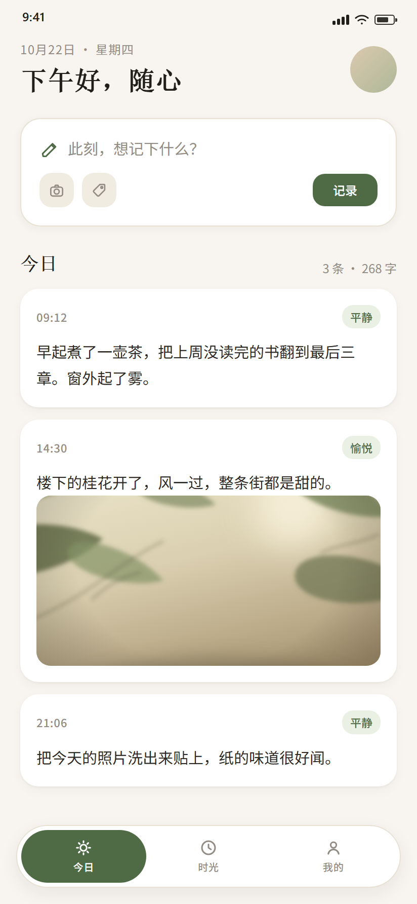
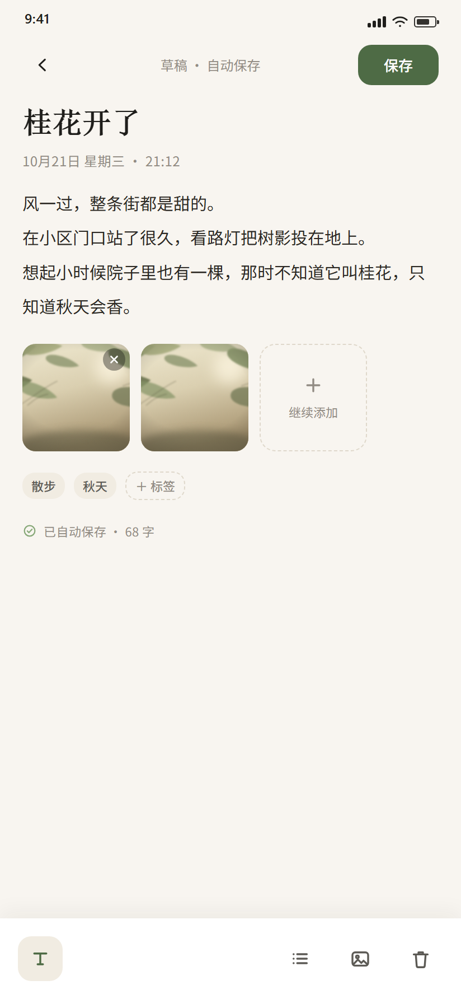
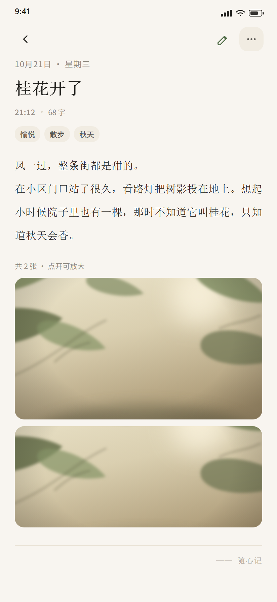
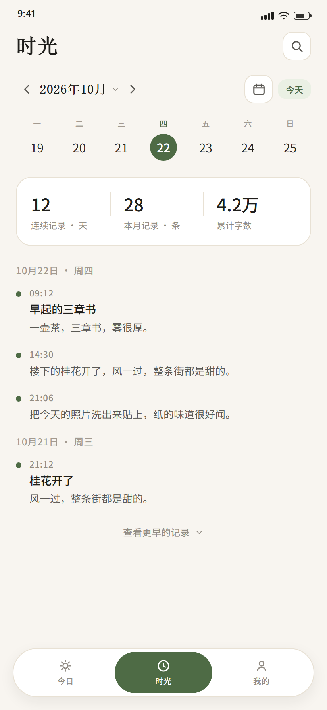
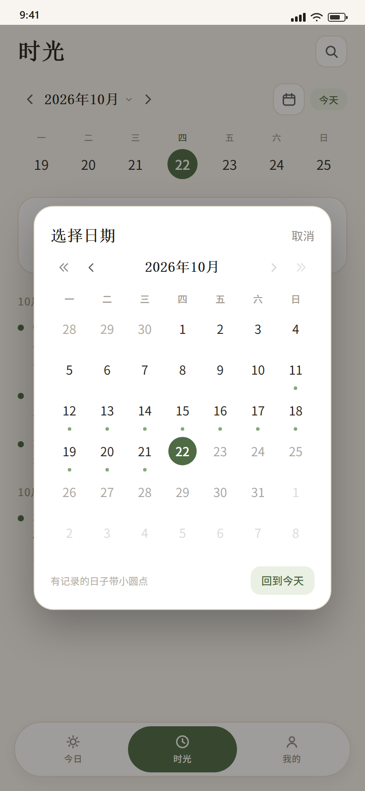
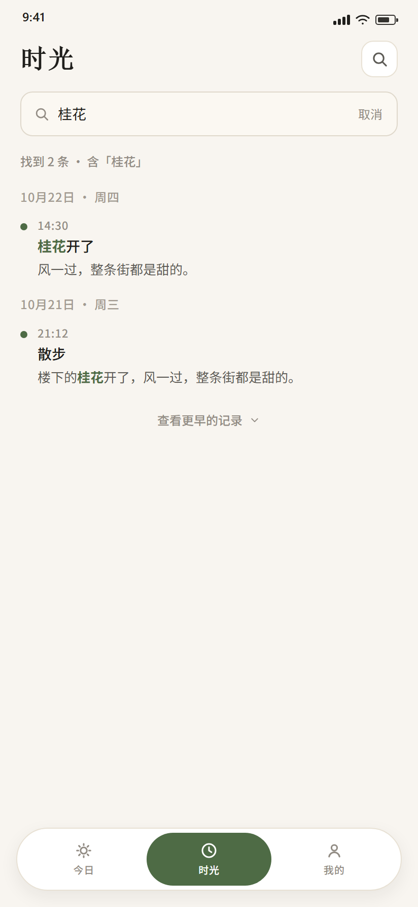
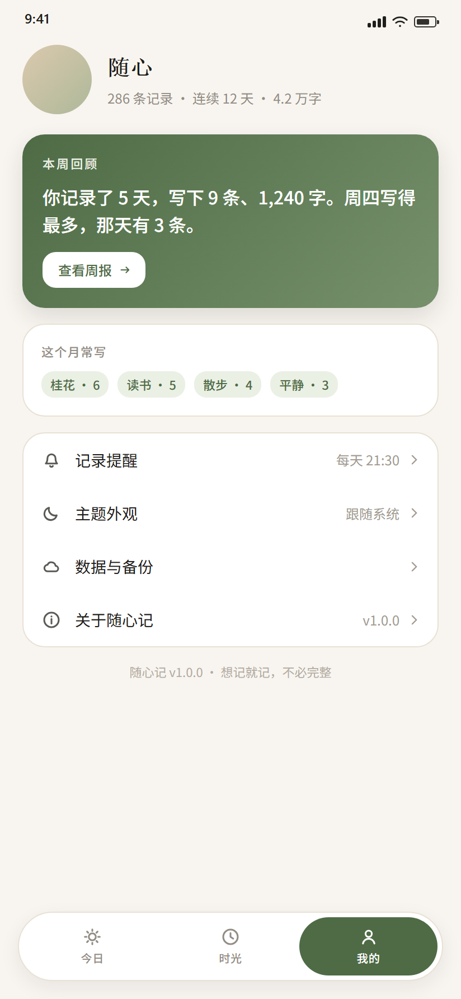
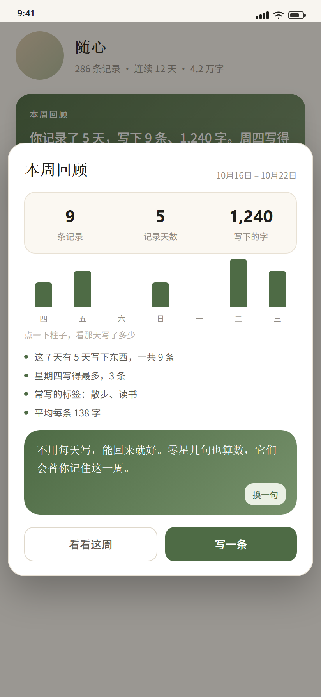
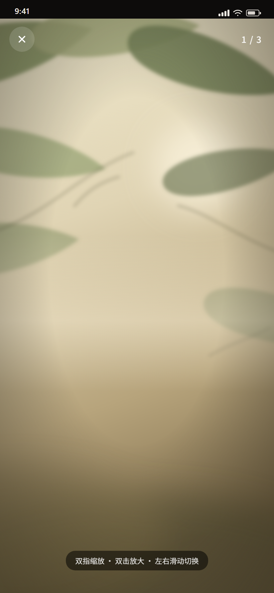
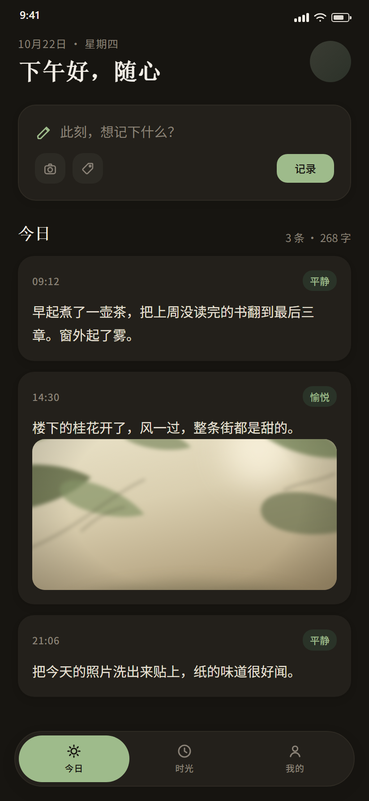

# 随心记 FreeNote

> 随手记录，轻回看，不打扰。一个纯原生 Android 日记应用。

原生 Java + XML · Room / SQLite · 单 Activity 三页 + 三个独立页 · 设计基准 412 × 892 dp · minSdk 24

## 效果图

| 今日 | 写记录 | 记录详情 |
| :--: | :--: | :--: |
|  |  |  |
| 问候随时段变化 · 快速记录 · 真实封面图 | 标题/正文/标签/心情/配图，防抖自动保存 | 沉浸阅读排版，可进编辑或删除 |

| 时光（按月） | 月历选日 | 关键词搜索 |
| :--: | :--: | :--: |
|  |  |  |
| 周历 + 统计 + 按天分组时间轴 | 整月一览，有记录的日期带圆点 | 标题/正文/标签模糊搜索，命中高亮 |

| 我的 | 本周回顾 | 全屏看图 |
| :--: | :--: | :--: |
|  |  |  |
| 头像、周报入口、标签统计、设置 | 7 天柱状图 + 洞察 + 100 条鼓励语 | 双指缩放 / 双击放大 / 左右翻页 |

| 深色模式 |
| :--: |
|  |
| 暖黑背景 + 提亮茶绿，跟随系统 / 浅色 / 深色三档 |

> 效果图由 `tools/mockups/gen_mockups.py` 按 `res/layout` 的层级、间距与 `colors.xml` 的色值渲染为 412×892 页面后截图，用于文档说明；本机没有可用的模拟器 / 真机，因此这不是设备截屏。图中配图为按 `bg_photo` 色系绘制的占位示意，实机为用户自己的照片。

## 功能

| 模块 | 实现 | 能力 |
| --- | --- | --- |
| 今日 | `ui/TodayFragment` | 日期与分时段问候；快速记录卡（拍照 / 相册 / 加标签 / 直接记录）；今日记录流带时间、心情、正文与封面图，点击进详情页，点封面直接全屏看图 |
| 写记录 | `ui/EditorActivity` | 标题、正文、标签、心情、最多多张配图；`700ms` 防抖自动保存；工具栏「拍一张 / 从相册选」；垃圾桶一步弹出确认框（删除后不会再被自动保存写回） |
| 记录详情 | `ui/NoteDetailActivity` | 衬线阅读排版（日期 / 标题 / 时间 · 字数 / 心情与标签 / 正文 / 配图 / 落款）；顶部返回、编辑、更多（编辑、删除）；`onResume` 重新加载，编辑或删除返回后自动同步 |
| 时光 | `ui/TimelineFragment` | 月份切换；周历（可左右滑动换周，今天描边、选中实心）；点任意日期筛选当天记录与统计，筛选条显示「10月22日 · 周四 · 3 条」；连续天数 / 本月条数 / 累计字数；按天分组时间轴；空日可直接补写到那一天 |
| 月历选日 | `ui/CalendarDialog` + `util/MonthGrid` | 周一开头的 6×7 网格，带相邻月日期；「‹ ›」翻月、「« »」翻年；有记录的日期带茶绿圆点，今天描边、选中实心，未来日期弱化不可点；「回到今天」一键落位 |
| 搜索 | `NoteDao.search` | 标题 / 正文 / 标签 `LIKE` 模糊匹配，`%`、`_` 已转义；输入 200ms 防抖；结果按天分组，关键词茶绿高亮；空结果给引导；返回键先退出搜索 |
| 我的 | `ui/ProfileFragment` | 自定义头像（相册选图，居中裁方，可恢复默认）；昵称可改；本周回顾文案由真实数据生成；常用标签按频次统计；记录提醒 / 主题 / 数据与备份 / 关于 |
| 本周回顾 | `ui/WeeklyReportDialog` + `util/Encouragements` | 近 7 天柱状图（点柱子看当天条数）；条数 / 天数 / 字数；最勤一天、常用标签、平均每条字数；按记录天数分四档共 100 条鼓励语，每次打开随机且不与上次重复，「换一句」必换；直达「写一条」「看看这周」 |
| 提醒 | `reminder/*` + `ui/ReminderDialog` | 可设每天几点；真实 `AlarmManager` 闹钟 + 通知；自绘数字滚轮（分钟 5 分钟一档）；关闭提醒会取消闹钟 |
| 全屏看图 | `ui/PhotoViewerActivity` + `ui/widget/ZoomImageView` | 黑底沉浸；双指缩放（上限 4×）、双击 2.5× 再双击还原、放大后可拖动并自动夹取边界；未放大时横滑交给 `ViewPager` 翻页；页码 `1 / 3`，单击收放顶栏 |
| 深色模式 | `values-night/` | 暖黑背景、提亮主色；跟随系统 / 浅色 / 深色，`FreeNoteApp` 启动时应用 |

## 技术栈

| 分层 | 选型 | 说明 |
| --- | --- | --- |
| 语言 | Java（source / target 1.8） | 无 Kotlin、无 Compose |
| 界面 | 原生 View + XML | 仅用 Material Components 提供 `Theme.MaterialComponents.DayNight.NoActionBar` 主题基类，不自带任何第三方 UI 框架；弹框、图表、缩放组件均自绘 |
| SDK | compileSdk 33 / targetSdk 32 / minSdk 24 | 最低兼容 Android 7.0 |
| 构建 | AGP 7.2.0 + Gradle 7.3.3 | 需 JDK 11+（本机用 IntelliJ 自带 JBR 17） |
| 持久化 | Room 2.4.3（SQLite） | `room-runtime` + `room-compiler` 注解处理 |
| 依赖 | appcompat 1.4.2 · material 1.5.0 · constraintlayout 2.1.4 · fragment 1.3.6 · activity 1.2.4 | 版本锁定原因见下方「构建」 |
| 系统能力 | AlarmManager / NotificationCompat / FileProvider / ActivityResult | 提醒、拍照、相册选图 |
| 测试 | JUnit 4.13.2 + Robolectric 4.11.1 + androidx.test:core 1.5.0 | JVM 上跑真实 Activity / Fragment / 数据库 |

## 应用架构

- **外壳**：`MainActivity` 承载三个 Fragment，`show()/hide()` 切换（保留各自滚动位置），底部为胶囊导航。
- **独立页**：编辑、详情、全屏看图各自是 Activity，互不干扰生命周期；全屏看图使用独立的 `Theme.FreeNote.Viewer`。
- **弹框**：统一自绘。`AppDialog`（提示 / 确认 / 单选 / 动作 / 输入）、`CalendarDialog`（月历）、`WeeklyReportDialog`（周报）、`ReminderDialog`（时间滚轮），都是纸白圆角卡片 + 衬线标题，不使用系统 `AlertDialog` 与 `DatePickerDialog`。
- **数据**：UI 只与 `data/NoteStore` 打交道；`NoteStore` 是仓库门面，内部持 `NoteDao`，负责实体与模型的互转、统计与示例数据。

```
app/src/main/java/com/crazymen/freenote/
├── MainActivity.java              三页容器 + 胶囊导航
├── FreeNoteApp.java               启动时应用主题模式、补排提醒闹钟
├── model/Note.java                领域模型：标题/正文/标签/心情/时间/配图/字数
├── data/
│   ├── NoteStore.java             仓库门面：查询、统计、保存、删除、导出、迁移
│   └── db/                        NoteEntity、NotePhotoEntity、NoteWithPhotos、NoteDao、NoteDatabase
├── ui/
│   ├── TodayFragment.java         今日
│   ├── TimelineFragment.java      时光（周历 / 日筛选 / 搜索）
│   ├── ProfileFragment.java       我的
│   ├── EditorActivity.java        写记录（自动保存 / 拍照 / 配图）
│   ├── NoteDetailActivity.java    记录详情
│   ├── PhotoViewerActivity.java   全屏看图
│   ├── AppDialog.java             通用弹框
│   ├── CalendarDialog.java        月历选日
│   ├── WeeklyReportDialog.java    本周回顾
│   ├── ReminderDialog.java        提醒时间
│   └── widget/ZoomImageView.java  双指缩放 / 双击 / 拖动
├── reminder/                      ReminderScheduler、ReminderReceiver、BootReceiver、ReminderNotifier
└── util/                          Dates、Prefs、PhotoStore、AvatarStore、MonthGrid、Encouragements
```

## 数据层

`NoteDatabase`（`freenote.db`，version 1）两张表：

**notes**

| 字段 | 类型 | 说明 |
| --- | --- | --- |
| `id` | long, PK | 与创建时间同源的毫秒戳 |
| `title` / `body` | TEXT | 标题可空；正文纯文本 |
| `created_at` / `updated_at` | long | 毫秒时间戳，列表与分组按 `created_at` |
| `mood` | TEXT，可空 | 心情（平静、愉悦、怀念…） |
| `tags_csv` | TEXT，可空 | 普通标签，逗号分隔存储 |

**note_photos**

| 字段 | 类型 | 说明 |
| --- | --- | --- |
| `id` | long, PK，自增 | |
| `note_id` | long，外键 → `notes.id` | `ON DELETE CASCADE`，并建索引 |
| `file_name` | TEXT | 只存文件名，不存绝对路径（换设备/换沙盒路径不失效） |
| `position` | int | 同一条记录内的展示顺序 |

`NoteWithPhotos` 用 `@Relation` 把配图聚合到主记录上，DAO 的列表 / 单条 / 搜索查询都带 `@Transaction`。

**统计口径**

- 字数：`body` 去掉所有空白字符后的长度（中文按字计）。
- 连续记录：从今天（今天没写则从昨天）向前逐日回溯，遇到空日即停。
- 常用标签：把 `tags_csv` 拆开按频次排序，取 Top N。
- 周报柱状图：`dailyCounts(startDay, 7)` 一次查出 7 天条数。

**首次启动**

若存在旧版 `notes.json`，导入数据库后改名为 `notes.json.migrated` 备份；否则写入一组示例记录（今日 3 条、昨日 3 条、更早 9 条），保证首屏不空。是否已初始化记录在 `Prefs.dataReady`。

## 图片与头像

**配图（`util/PhotoStore`）**

1. 相册返回 `content://` Uri 后，先整段复制到 `cacheDir` 临时文件 —— 部分相册 / 文档提供方的流不可重复读，直接从 Uri 反复解码会失败。
2. 从临时文件读尺寸，按**长边**算采样率解码（避免 4000×3000 直接进内存）。
3. 按 EXIF 摆正，长边限制 1600px，JPEG 质量 86 落盘到 `filesDir/notes_photos/`。
4. 数据库只写文件名；列表读取走采样解码 + `LruCache`；删除记录时级联删表记录，同时删文件。

**拍照**

`FileProvider`（authority `${applicationId}.fileprovider`，只开放 `cacheDir/captures/`）把临时文件交给系统相机写入，拍完仍走上面同一条导入链路；原图用完即删，超过 1 天的残留会在下次拍照时清理。

**头像（`util/AvatarStore`）**

相册选图 → 居中裁方 → 缩放至 512px → JPEG 90 存到 `filesDir/avatar/avatar.jpg`；展示时用 `RoundedBitmapDrawable` 圆形裁切，无自定义头像则回落到 `bg_avatar` 渐变。今日页与我的页共用同一份文件。

## 提醒（AlarmManager + 通知）

- `ReminderScheduler` 只排**下一次**：`nextTrigger(hour, minute)` 算最近一个未来时刻，`setAndAllowWhileIdle(RTC_WAKEUP, ...)` 注册。
- 到点 `ReminderReceiver` 先发通知，再排次日；`BootReceiver` 处理 `BOOT_COMPLETED` 与 `MY_PACKAGE_REPLACED`；`FreeNoteApp` 每次启动补排一次（防止「强行停止」后系统清空闹钟）。
- `ReminderNotifier` 建 `freenote_daily_reminder` 通道，通知文案按一年中的第几天轮换，点通知回「今日」。
- 权限：`POST_NOTIFICATIONS`（Android 13+）、`RECEIVE_BOOT_COMPLETED`。刻意不用精确闹钟，因此不需要 `SCHEDULE_EXACT_ALARM`，代价是系统可能把触发时间推迟几分钟 —— 对日记提醒可以接受。
- 设计取舍：不用 `setRepeating`。重复闹钟在用户改时间后会残留旧任务，单次 + 自续订更容易保证「只有一个待触发闹钟」，也能被 `cancel()` 干净取消。

## 设计系统

**色彩**

| 语义 | 浅色（暖纸） | 深色（暖黑） |
| --- | --- | --- |
| 背景 `bg` | `#F8F5F0` | `#171511` |
| 卡片 `surface` | `#FFFFFF` | `#23201B` |
| 主文字 `ink` | `#1F1E1B` | `#F4EFE7` |
| 次要文字 `text_secondary` | `#5C5A55` | `#A8A096` |
| 主色 `primary`（茶绿） | `#4E6B45` | `#9EBB8B` |
| 主色底 `primary_soft` | `#EAF0E4` | `#2A3328` |
| 强调 `clay`（陶土） | `#D89575` | `#DCA98F` |
| 危险动作 `danger` | `#A9613F` | `#DCA98F` |
| 分隔 `divider` | `#E8E1D4` | `#2E2A23` |

**字阶**

| 用途 | 字号 / 行距 | 字体 |
| --- | --- | --- |
| Display（页面大标题、问候） | 26sp | serif 粗 |
| Title / Section | 20sp / 18sp | serif 粗 |
| 阅读正文（详情） | 16sp，行距 +11sp | serif |
| 正文（列表、编辑） | 15sp，行距 +10sp | sans |
| Meta / Caption / Label | 12sp / 11sp | sans，Label 加字距 |
| 数字（统计） | 22sp | sans-medium |

**形状与间距**：间距取 4 的倍数，页面左右留白 20dp；圆角卡片 18–20dp、按钮 12dp、标签 11dp、导航胶囊 36dp；所有可点区域 ≥ 44dp（图标按钮视觉 36dp，容器补足）。

**图标**：全部为 `res/drawable` 下的矢量（`ic_*.xml`），线条统一 1.7–1.8 描边、圆头圆角；应用图标为茶绿渐变底 + 纸白便签（折角、三行字迹、陶土落款点），API 26+ 用自适应图标，API 24/25 用 `tools/icon_gen.py` 生成的各密度位图。

## 构建与运行

```bash
# 需要 JDK 11 及以上；本机默认 JAVA_HOME 为 JDK 8，需显式指定 17
JAVA_HOME=/path/to/jdk17 ./gradlew :app:assembleDebug
adb install -r app/build/outputs/apk/debug/app-debug.apk
```

Android Studio 打开工程后把 Gradle JDK 设为 11 / 17 即可直接运行。

**为什么锁依赖版本**：AGP 7.2 只支持到 `compileSdk 32/33`，而 appcompat 1.8.0、material 1.9+ 要求 `compileSdk 34`，直接升级会在 `checkDebugAarMetadata` 阶段失败。这里把 appcompat 锁在 1.4.2、material 锁在 1.5.0、Room 锁在 2.4.3，与 AGP 7.2 + JDK 17 组合可稳定构建。若后续把 AGP 升到 8.x，再一并升级这三者即可。

## 测试

```bash
JAVA_HOME=/path/to/jdk17 ./gradlew :app:testDebugUnitTest
```

`UiSmokeTest`（Robolectric，**24 个用例**）在 JVM 上跑真实 Activity / Fragment / Room，覆盖：

| 分组 | 用例 |
| --- | --- |
| 首屏与导航 | `todayScreenRendersSeededNotes`、`switchingTabsRendersEachScreen`、`darkModeUsesWarmBlackTokens` |
| 记录读写 | `quickCaptureCreatesNote`、`editorSavesAndPersistsText`、`emptyEditorDoesNotCreateNote`、`noteFieldsPersistAcrossStoreRestart`、`backdatedNoteLandsOnChosenDay` |
| 删除 | `deletingNoteShowsSingleDialogAndRemovesIt`（断言只弹一个框，且重启数据库后查不到） |
| 日期 | `timelineDayTapFiltersListAndStats`、`monthGridStartsMondayAndCoversWholeMonth`、`calendarPickerJumpsStraightToAnyPastDay` |
| 搜索 | `searchFindsNotesByKeyword`（正文命中 / 标签命中 / 空结果 / 退出） |
| 图片 | `photoImportReadsContentUri`（走完整 `content://` 导入链路）、`photoPersistsAndIsCleanedWithNote`、`photoToolOffersCameraAndGallery`、`photoViewerPagesThroughAllPhotos` |
| 详情与交互 | `tappingNoteOpensDetailInsteadOfEditor`、`detailPageRendersNoteAndOpensEditor`、`voiceEntryIsGone` |
| 周报与提醒 | `weeklyReportShowsRealDataAndInteractions`、`encouragementsCoverFourTiersWithHundredLines`、`reminderSchedulesAlarmAndPostsNotification`（排闹钟 → 发通知 → 续订次日）、`reminderDialogSavesTimeAndToggle` |

## 已知限制

- 效果图为布局渲染示意，非设备截屏；真机上字体（Noto Serif SC）与系统栏高度会略有差异。
- 提醒为「每天一次」的固定时间，不区分工作日 / 周末，也不提供「稍后提醒」。
- 数据仅保存在应用私有目录（Room + 文件），没有云同步；「数据与备份」目前提供复制全部文本导出。
- 全文搜索为 `LIKE` 匹配，不含分词与拼音搜索。
- 图片查看为自绘缩放组件，未引入第三方图片库；超大图（> 8000px）会先按 1600px 落盘再展示。
